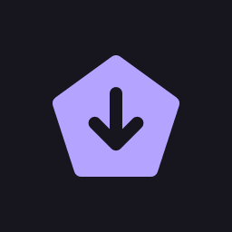
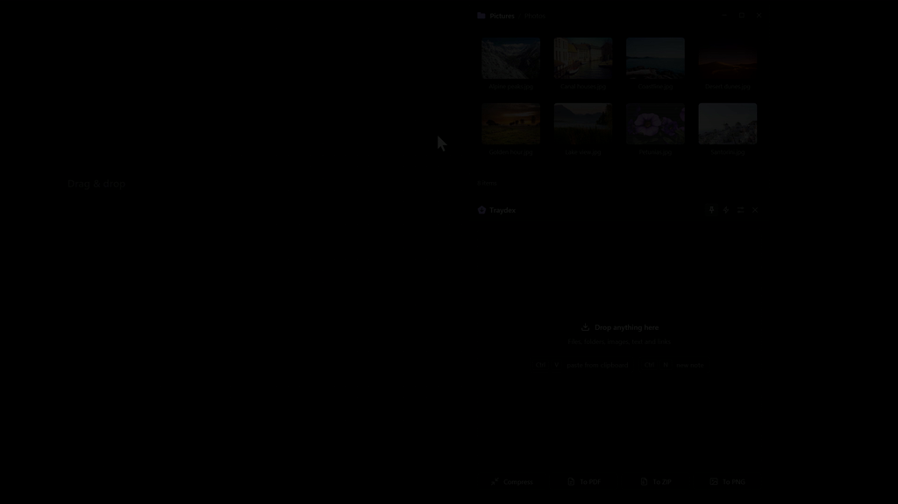
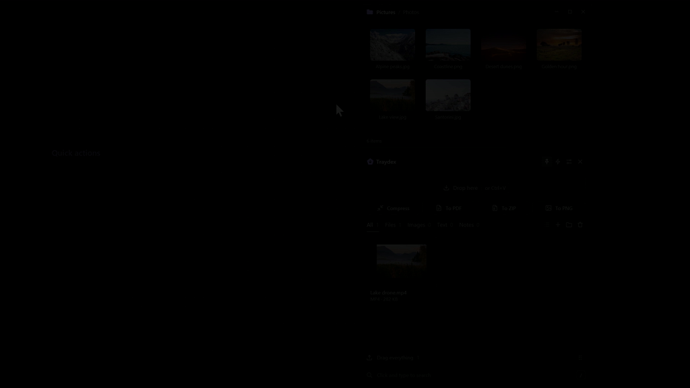
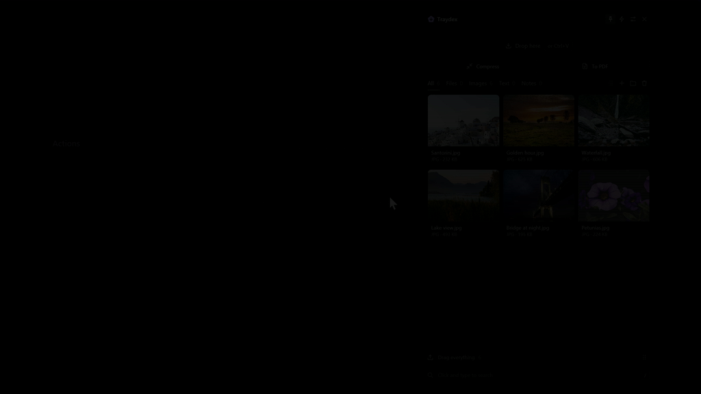
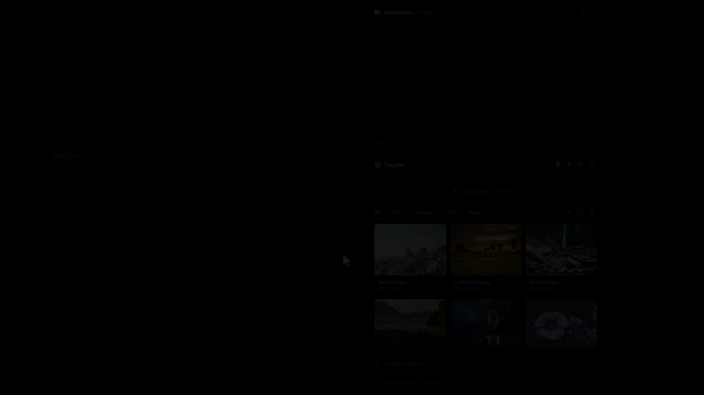
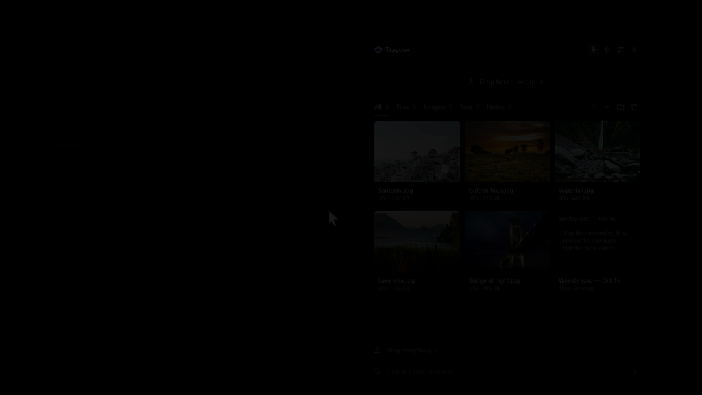
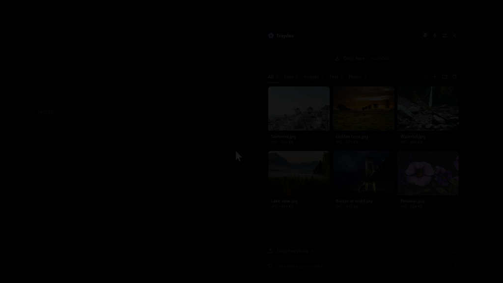
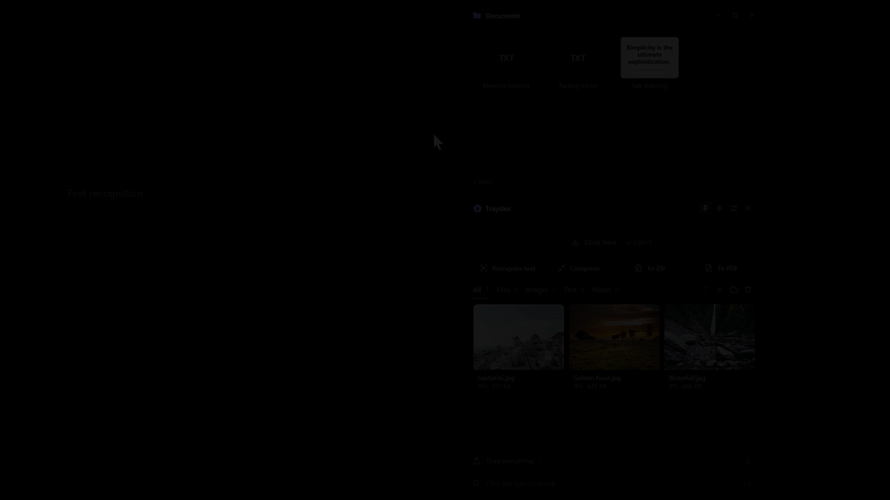
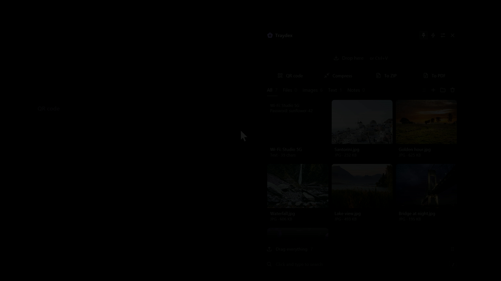
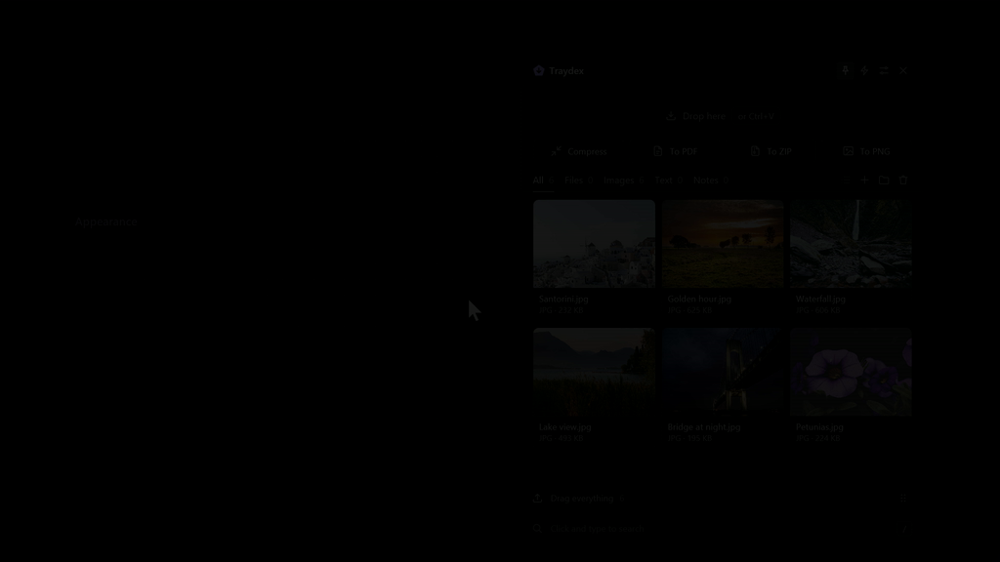

# Traydex

A native drop shelf for Windows, written in Rust. 
It appears when you start dragging a file and keeps files, images, text and links at hand.

English | [Русский](README.ru.md)

 

<!-- SHOWREEL: paste the https://github.com/user-attachments/assets/... link of the uploaded showreel video on the next line -->

Traydex is a panel that opens as soon as you start dragging something in Windows. Drop files, folders, images,
text or links on it to keep them for later, then drag them out into any folder or app, one by one or all at once.
Dropping on one of the action tiles instead processes the files right away: zip, convert, compress, make a PDF,
recognize text, upload and more.

**Native, with no web engine inside.** Traydex is written in Rust on [GPUI](https://www.gpui.rs/), the
GPU-accelerated UI framework of the [Zed](https://zed.dev/) editor. It doesn't use Electron, Tauri, WebView or any
other browser engine: the interface is drawn directly with DirectX. It's a single executable that starts quickly
and stays light while it waits in the tray.

> **Note:** this is an alpha version. I use Traydex every day, but there will be bugs. If you find one, please
> [report it](https://github.com/ipavlin98/traydex/issues/new/choose).

## Download

The latest version is on the [Releases](https://github.com/ipavlin98/traydex/releases/latest) page:

| | Installer | Portable |
|---|---|---|
| 64-bit (most PCs) | `Traydex-<version>-x64-setup.exe` | `Traydex-<version>-x64-portable.zip` |
| ARM64 (Snapdragon, Surface Pro X) | `Traydex-<version>-arm64-setup.exe` | `Traydex-<version>-arm64-portable.zip` |
| 32-bit Windows 10 | `Traydex-<version>-x86-setup.exe` | `Traydex-<version>-x86-portable.zip` |

If you're not sure, choose **x64**. Your system type is shown in *Settings → System → About*.

- **Installer:** installs for the current user without admin rights, adds a Start menu shortcut and an entry in
  *Installed apps*.
- **Portable:** a folder that can live anywhere, including a USB drive. All data stays in the `data` folder next to
  the exe, and Traydex doesn't start with Windows unless you turn that on.

After launch Traydex runs in the tray. Start dragging any file to open the shelf.

Traydex checks GitHub for a new version at startup and once a day and offers it at the bottom of the window. **Update**
downloads the file for your system (installer or portable, x64, ARM64 or x86), verifies its SHA-256 checksum, installs
it and restarts Traydex. Alpha builds are offered alpha and stable releases; stable builds only stable ones. Check by
hand with the button next to the version at the bottom of Settings, or turn automatic checks off there.

Requirements: Windows 10 (1803 or newer) or Windows 11.

The app isn't code-signed yet, so Windows may show "Windows protected your PC" on the first launch. Click
**More info → Run anyway**. Releases are built from this repository by
[GitHub Actions](https://github.com/ipavlin98/traydex/actions/workflows/release.yml) and include SHA-256 checksums.

## Features

### Opening the shelf

The shelf opens when a drag starts and hides when you click outside it. It can also be opened with a hot corner,
`Ctrl+Shift+Space` (configurable) or the tray icon. With *Only on shake* enabled, it opens only when you shake the
cursor during a drag.

### Actions on drop

During a drag, the shelf shows action tiles. A photo dropped on *Compress* gets a smaller copy next to it; several
images dropped on *To PDF* become one document. Progress is shown in the title bar, and the result is added to the
shelf.

### Tile setup

Choose which tiles to show, change their order and configure each one: target folder, search engine, upload server
and so on. All available actions are listed [below](#quick-actions).

<table>
<tr>
<td width="50%" valign="top">

### Dragging out

Select several cards and drag them into a folder or an app. *Drag everything* moves the whole shelf at once.  

</td>
<td width="50%" valign="top">

### Preview

Double-click a card or press `Space`. Images, text, code, folders, archives, PDF and Office files open inside the
panel; the arrow keys switch between them. The mouse wheel zooms into a photo, dragging moves it.  

</td>
</tr>
<tr>
<td width="50%" valign="top">

### Notes and search

`Ctrl+N` creates a note that saves as you type. `/` searches the shelf, tolerating typos and text typed in the
wrong keyboard layout.  

</td>
<td width="50%" valign="top">

### Text recognition

Drop a screenshot, a photo or a scanned PDF on *Recognize text* to copy its text. It uses the OCR built into
Windows and works offline.  

</td>
</tr>
<tr>
<td width="50%" valign="top">

### QR codes

Show a link or a note as a QR code. *To phone* does the same for files: scan the code to open them on a phone over
Wi-Fi.  

</td>
<td width="50%" valign="top">

### Appearance

List or grid view, light or dark theme, transparency and blur. Available in English, Russian, Chinese, Hindi,
Spanish and French.  

</td>
</tr>
</table>

### Watched folders

Add folders such as *Downloads* in Settings, and their files and subfolders appear on the shelf by themselves, new
ones included. A card goes away when its file is deleted or moved; a card you remove yourself doesn't come back.

## Quick actions

| Tile | What it does |
|---|---|
| Folder | Moves or copies files to a chosen folder |
| ZIP archive, Extract | Packs files into a ZIP; extracts ZIP, 7z, RAR, TAR and other archives |
| To JPEG, To PNG, Compress photos | Converts images or makes a smaller copy (MozJPEG or WebP) |
| To PDF | Joins images and text files into one PDF |
| Recognize text | Copies text from screenshots, photos and scanned PDFs |
| QR code, To phone | Shows text as a QR code; shares files with a phone over Wi-Fi |
| Rename | Renames files by a rule: date and number, custom name, transliteration, web-friendly names |
| Web search | Searches text, file names or images in Google, Bing, Yandex, DuckDuckGo, YouTube or a custom engine |
| Imgur, Custom server | Uploads a file and copies the link |
| File hash | SHA-256 and MD5, with an optional VirusTotal check |
| Video to GIF, Download video | Converts a video to GIF; downloads a video by link (ffmpeg / yt-dlp are downloaded on first use) |
| Copy path, Base64 | Copies full file paths, or a file as a `data:` URI |
| Program | Passes files to any program or script |
| Plugins | Custom tiles in PowerShell, Python, `.bat` or `.exe` ([documentation](docs/plugins.md)) |

## Shortcuts

| Action | Keys |
|---|---|
| Show or hide the shelf | `Ctrl+Shift+Space` |
| Paste from clipboard | `Ctrl+V` |
| New note | `Ctrl+N` |
| Search | `/` |
| Preview | `Space` or double-click |
| Open | `Enter` |
| Copy, delete | `Ctrl+C`, `Delete` |
| Select all, select a range | `Ctrl+A`, `Shift`+click |
| Pin to the top | `P` |
| List / grid | `Ctrl+G` |
| Cancel a drag and hide the shelf | Right-click while dragging |
| Hide | `Esc` |

Explorer's context menu also gets a *Send to Traydex shelf* item (on Windows 11, under *Show more options*).

## Data and privacy

All data is stored locally: in `%LOCALAPPDATA%\Traydex`, or in the `data` folder of the portable version. There are
no accounts and no telemetry. Traydex connects to the internet only for tiles that need it (uploads, web search,
VirusTotal and downloading ffmpeg) and to check GitHub for updates, which can be turned off in Settings. Files from Explorer aren't copied; the shelf stores a link to the original, and a card shows the folder the file is in.
Pasted images and files from browsers are kept in Traydex itself: their cards say *Stored only in Traydex*.
Removing such a card sends the file to the Recycle Bin, and restoring it there brings the card back; with that
setting off, Traydex asks first, because the file is deleted for good. Logs are in the `logs` subfolder.

## FAQ

**How do I disable autostart?**
Settings → *Start with Windows*.

**The shelf opens too often.**
Enable *Only on shake*, or disable *Show while dragging* and use the shortcut or a hot corner.

**How do I uninstall it?**
Installer version: *Settings → Apps → Installed apps*. Portable version: turn off *Start with Windows* and the
Explorer menu item in Settings, quit from the tray icon and delete the folder.

**Is there a macOS or Linux version?**
No. Traydex is built around Windows drag-and-drop, Explorer and the tray.

## Plugins

A plugin is a tile backed by your own script in PowerShell, Python, `.bat` or any `.exe`. Add an `action.json`,
pack the folder as `.tdx` and drop it on Traydex to install. See [docs/plugins.md](docs/plugins.md) and the examples
in [examples/plugins](examples/plugins). The complete description of every feature is in the
[manual](docs/manual.md).

## Contributing

Bug reports, ideas and pull requests are welcome. Build instructions and code rules are in
[CONTRIBUTING.md](CONTRIBUTING.md).

## License

[MIT](LICENSE). Third-party licenses are listed in `THIRD-PARTY-NOTICES.txt`, included in every release.
</content>
